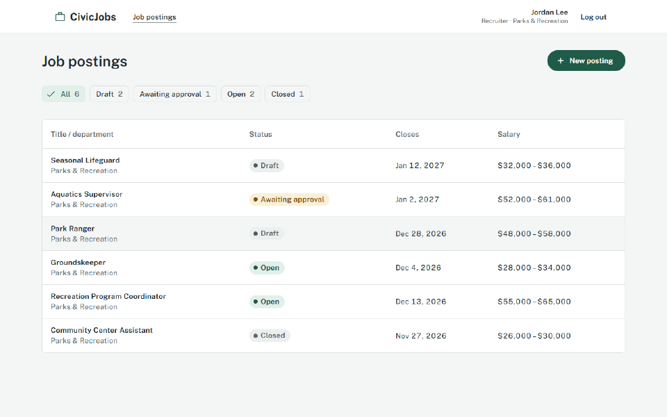
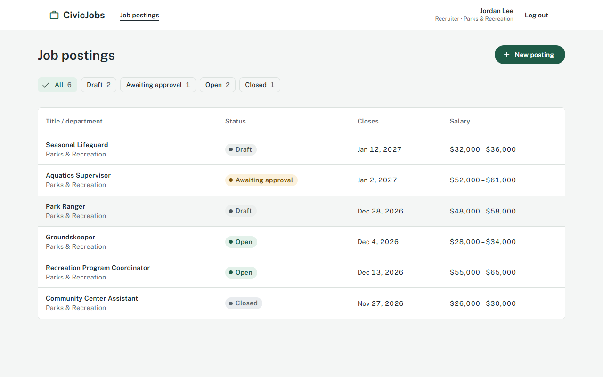
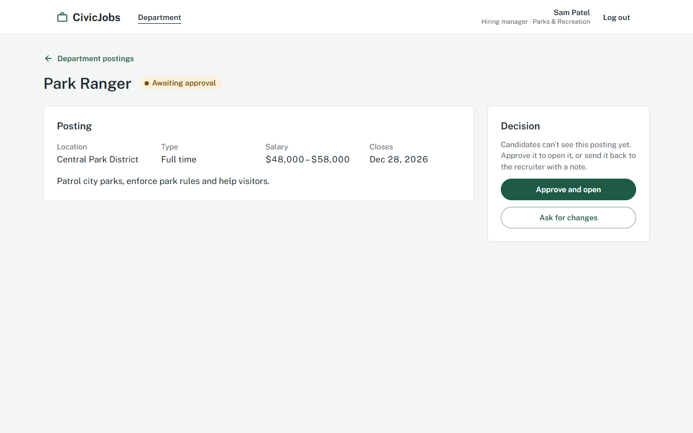
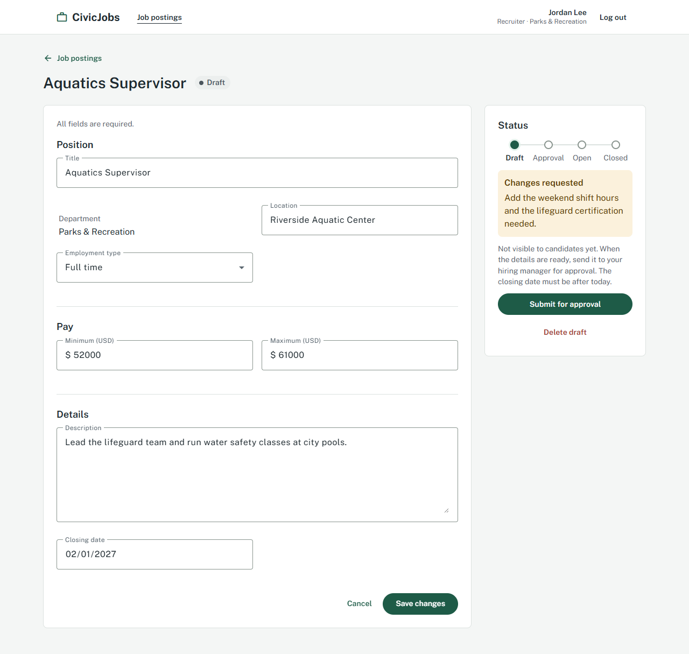
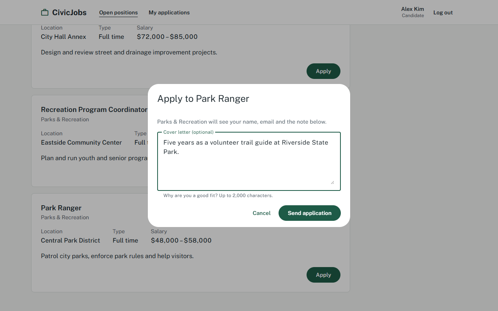
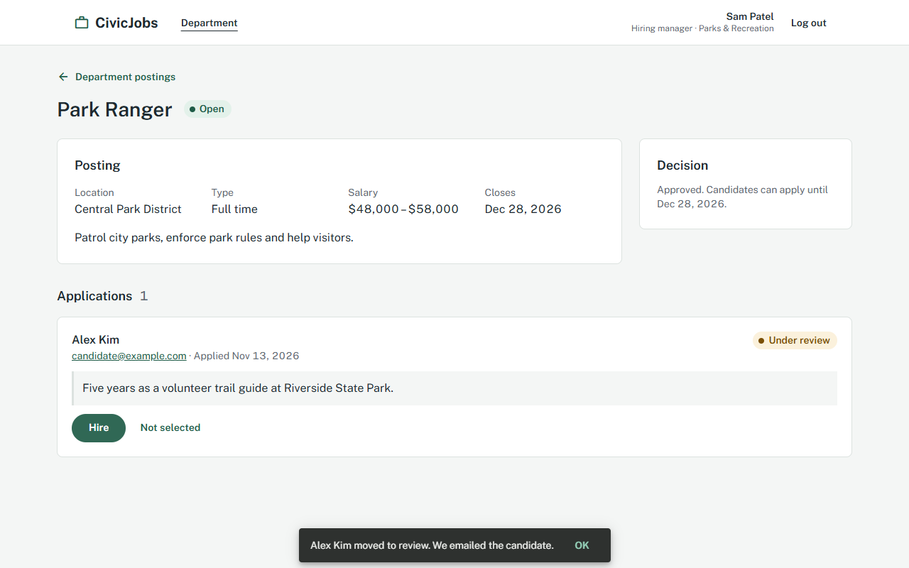
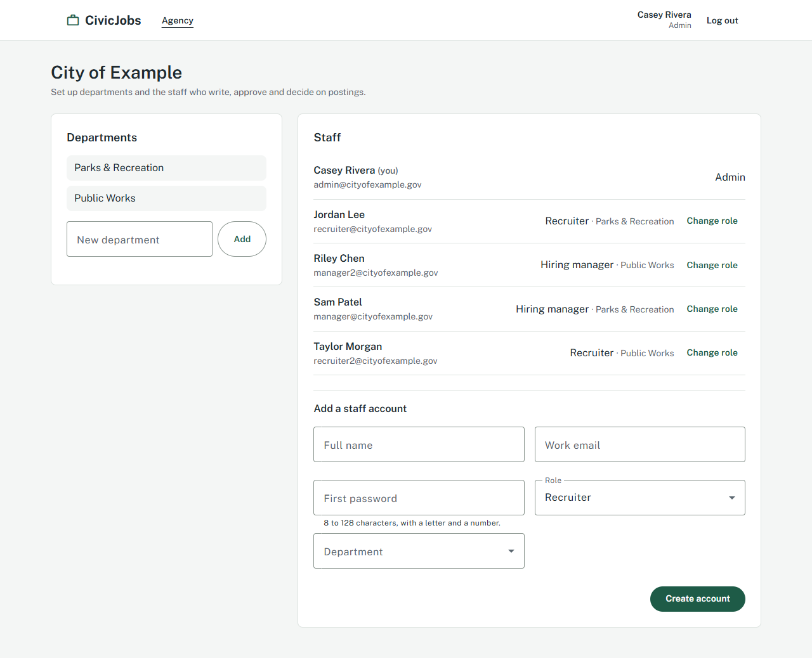

# CivicJobs

CivicJobs is a job posting manager for public sector HR: recruiters write postings for their department, the department's hiring manager approves them, candidates apply, and the hiring manager decides on each application. An agency admin sets up departments and staff roles. It has an Identity API (accounts, roles, departments), a Jobs API (postings and applications) and an Angular frontend, sharing one SQLite database seeded with demo data.



Requirements and the API contract: [docs/PRD.md](docs/PRD.md) and [docs/user-story.md](docs/user-story.md).

## Run with Docker

Needs Docker with Compose. From the repository root:

```
docker compose up --build
```

| What | URL |
|---|---|
| App | http://localhost:4200 |
| Identity API (Swagger) | http://localhost:5101/swagger |
| Jobs API (Swagger) | http://localhost:5102/swagger |

All demo passwords are `Demo@12345`:

| Email | Role | What to try |
|---|---|---|
| `recruiter@cityofexample.gov` | Recruiter, Parks & Recreation | Create a posting and submit it for approval |
| `manager@cityofexample.gov` | Hiring manager, Parks & Recreation | Approve or send back postings, decide on applications |
| `candidate@example.com` | Candidate | Apply to an open position, follow My applications |
| `admin@cityofexample.gov` | Admin, City of Example | Add departments and staff, change roles |
| `recruiter2@cityofexample.gov`, `manager2@cityofexample.gov` | Public Works | Show that departments don't see each other's postings |

Anyone can browse open positions without logging in at http://localhost:4200/open-positions, and register as a candidate.

The database lives in the `civicjobs-data` volume and is seeded on the first start. To start over with fresh demo data:

```
docker compose down -v
docker compose up --build
```

## Run locally

Needs the .NET 10 SDK and Node.js 22.22 or later, or 24.15 or later (required by Angular 22). Run each command in its own terminal:

```
cd backend && dotnet run --project CivicJobs.Identity.Api   # http://localhost:5101/swagger
cd backend && dotnet run --project CivicJobs.Jobs.Api       # http://localhost:5102/swagger
cd frontend && npm install && npm start                     # http://localhost:4200
```

Both APIs migrate and seed `backend/civicjobs.db` on startup in Development. Delete that file to start over.

**Coming from version 1.0?** Delete `backend/civicjobs.db` (or run `docker compose down -v`) before the first start. The 1.0 accounts have no agency or department, so the migration turns them into candidates, and the seed only runs on an empty database.

## Tests

```
cd backend && dotnet test
cd frontend && npm test
```

## Features by role

| Role | Pages | Rules worth knowing |
|---|---|---|
| Recruiter | Job postings, posting detail | Postings start as Draft and go to the hiring manager with **Submit for approval**. The department comes from the account. |
| Hiring manager | Department postings, posting detail with applications | **Approve and open** or **Ask for changes** (back to Draft with a note). Applications move Submitted → Under review → Hired or Not selected. |
| Candidate | Open positions, My applications | One application per posting, with an optional cover letter. An email (written to the Jobs API log) confirms the application and every status change. |
| Admin | Agency | Departments, staff accounts and roles. Admins can't change their own role. |

Open postings close by themselves once their closing date has passed (checked every hour by the Jobs API).

## Screenshots

| | |
|---|---|
|  |  |
| Recruiter: postings in every status | Hiring manager: approve or ask for changes |
|  |  |
| Recruiter: changes requested by the manager | Candidate: apply with a cover letter |
|  |  |
| Hiring manager: decide on applications | Admin: departments and staff roles |

At 375 px wide: [open positions](docs/screenshots/13-mobile-open-positions.png), [hiring manager posting](docs/screenshots/14-mobile-manager-posting.png), [admin](docs/screenshots/15-mobile-admin.png). Every screenshot is in [docs/screenshots/](docs/screenshots/).

## Architecture

Clean Architecture with plain services (no CQRS or MediatR). Arrows point to what each part depends on.

```
Angular frontend
      │  HTTP: /identity → Identity API, /jobs → Jobs API
      ▼
┌────────────────┬────────────────┐
│  Identity API  │    Jobs API    │   controllers, JWT auth, Swagger, error handling
└────────────────┴────────────────┘
         │                 │
         ▼                 ▼
  Infrastructure ──────► Application ──────► Core
  EF Core, SQLite,       services,           entities, business rules,
  JWT, hashing,          validators,         repository interfaces
  email to the log       abstractions
```

- **Dependency rule:** dependencies point inward.
  - Both APIs reference Application and Infrastructure.
  - Infrastructure references Application and Core.
  - Application references only Core, never Infrastructure.
  - Core references nothing.

  Business rules live in Core entities or Application services, never in controllers or repositories.
- **Interfaces apart from their implementations:** `Application/Services/Interfaces` and `Application/Services/Implementations`, `Application/Abstractions` for what Infrastructure implements (password hashing, tokens, email), and `Core/Repositories` for the repository interfaces.
- **Shared between the APIs:** both read the same `Jwt` settings (issuer, audience, key), so a token from the Identity API works in the Jobs API, and both use the same SQLite database file.

## Project structure

```
backend/
  CivicJobs.Core/               entities, enums, domain exceptions, repository interfaces
  CivicJobs.Application/        Services/Interfaces, Services/Implementations, validators, input and view models, abstractions
  CivicJobs.Infrastructure/     EF Core + SQLite, migrations, seed, JWT, password hashing, shared web setup
  CivicJobs.Identity.Api/       register, login, logout, current user, departments and staff (admin)
  CivicJobs.Jobs.Api/           postings (recruiter), approval and applications (hiring manager),
                                applications (candidate), the public list and the hourly close of expired postings
  CivicJobs.UnitTests/          Core, Application and Infrastructure tests
  CivicJobs.*.ApiTests/         endpoint tests for each API
frontend/                       Angular app (core, features per role, shared)
docs/                           PRD, user story and screenshots
genai-exercise/                 GenAI part of the exercise
docker-compose.yml
```

## Key decisions and assumptions

- **A second API, read as a separate Identity API** for accounts, roles, departments and staff. The Jobs API accepts its tokens. See [PRD section 10](docs/PRD.md#10-assumptions-and-constraints).
- **Public registration creates candidates only.** Staff accounts come from an agency admin, so nobody can give themselves a staff role. The role is a token claim, so a change applies at the next login.
- **A hiring manager approves every posting** of their department before candidates see it; postings and applications of another department return 404, like another recruiter's posting.
- **Another recruiter's posting returns 404**, not 403, so the API doesn't reveal that the id exists (BR-08). See [PRD section 7](docs/PRD.md#7-business-rules).
- **Validation in two places:**
  - the validator returns 400 with the error next to each form field
  - the entity guards its own rules, so invalid data can't be saved from anywhere else

  See [PRD section 7](docs/PRD.md#7-business-rules).
- **Typed exceptions, mapped in one place:**
  - 400: invalid data
  - 409: an action the status doesn't allow, or an email already in use
  - 404: not found, or not yours
  - 401: wrong credentials, or an expired session

  See [PRD section 7](docs/PRD.md#7-business-rules).
- **`TimeProvider` for date rules** (closing date, publishing), so the tests can fix "today". "Today" means the UTC date. See [PRD section 10](docs/PRD.md#10-assumptions-and-constraints).
- **SQLite for zero setup:** no database to install, and demo data is seeded on start. See [PRD section 8](docs/PRD.md#8-non-functional-requirements).
- **Session in an httpOnly cookie** (Secure, SameSite=Strict), so page scripts can't read the token. The frontend only keeps when the session expires, to skip the session check on anonymous visits. The APIs still accept a Bearer header for Swagger and API clients. See [PRD section 10](docs/PRD.md#10-assumptions-and-constraints).
- **Expired postings close in the Jobs API**, in a `BackgroundService` that runs every hour, not in a separate worker project: one SQLite database and one instance don't need one.
- **Emails are written to the log** through `IEmailSender`. A real SMTP or email service only needs a new implementation in Infrastructure.

## How AI was used

I used Claude Code as my coding assistant, with guardrails I set up for this project:
- **[CLAUDE.md](CLAUDE.md)** holds the rules I defined: architecture, tests and conventions.
- **The `tdd-cycle` skill** follows the workflow I chose: failing tests first, then the code.
- **The `architecture-reviewer` agent** checked each block for layer violations, ownership and weak tests before I merged it.
- **The `frontend-design` plugin** helped with the UI pass, following the visual direction I picked.

I wrote the requirements (PRD and user story), made the design decisions and reviewed the code at the end of each block. The commit history shows each step. The GenAI part of the exercise (prompt, raw output and my review) is in [genai-exercise/](genai-exercise/).
